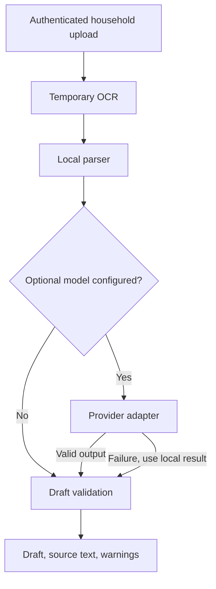

# RecipeLens Sprint 2: structured recipe drafts

Related stories: US-02 (#3), US-03 (#4).

Sprint 1 returns OCR text. Sprint 2 adds a separate draft endpoint that extracts
recipe fields and reports what a person must review. It never creates a recipe,
household item, or permanent upload. The existing `/scan` and URL importer are
unchanged. Flutter review, ingredient matching, duplicate warnings, confirmed
saving, and hosting configuration remain separate increments.

## Request

Build and run the backend from this repository, including the Sprint 1 OCR
dependencies. The default Compose file references upstream images and does not
build the extension. Use an existing household account and access token.

```sh
curl -X POST \
  -H "Authorization: Bearer $KITCHENOWL_ACCESS_TOKEN" \
  -F "file=@printed-recipe.png" \
  "http://localhost:5000/api/household/1/recipe/scan/draft"
```

Input is the same as Sprint 1: multipart `file`, PNG/JPEG or single-page PDF,
maximum 10 MB. Authentication and household access are checked before OCR.

## Version 1 response contract

```json
{
  "schema_version": 1,
  "source_text": "Toast\nIngredients\n1 slice bread\nInstructions\nToast bread.",
  "extraction_method": "local",
  "draft": {
    "title": "Toast",
    "ingredients": ["1 slice bread"],
    "instructions": ["Toast bread."],
    "servings": null,
    "prep_time": null,
    "cook_time": null
  },
  "validation": {"valid": true, "errors": []},
  "warnings": [
    {"field": "servings", "code": "missing", "message": "Servings was not found."},
    {"field": "prep_time", "code": "missing", "message": "Preparation time was not found."},
    {"field": "cook_time", "code": "missing", "message": "Cooking time was not found."}
  ],
  "recipe_payload": {"name": "Toast", "description": "Toast bread."},
  "requires_review": true
}
```

- Time values are integer **minutes**; unknown values are `null`.
- Ingredients retain quantities and units from the recognized lines. Bullets and
  step numbering are removed; the complete OCR text is preserved separately.
- Missing title, ingredients, or instructions produce field-specific `required`
  errors and `validation.valid: false`. The endpoint still returns HTTP 200 so a
  later review screen can edit the incomplete draft. `recipe_payload` is then null.
- Missing servings/times are warnings, not blockers. Printed ranges, negative
  values, fractional durations, and conflicting metadata are not guessed.
- `validation.valid` describes structural completeness, **not extraction accuracy
  or permission to save**. Every draft requires review, including provider output.
- `recipe_payload` maps title to `name`, instructions to `description`, and
  servings to `yields`. It is a partial mapping for the next sprint, not a full
  save request: ingredients still need household-item matching.
- Warnings have stable `field` and `code` keys; clients should not parse messages.
  No uncalibrated numeric confidence scores are returned.

## Parsing and validation

The default path is entirely local and requires no model credentials. It reads
English headings `Ingredients`, `Instructions`, `Directions`, `Method`, or
`Steps` (including inline `Ingredients: ...`), the first nonmetadata title line,
and labelled servings/preparation/cooking times. It accepts durations such as
`10 minutes` and `1 hour 5 minutes`. Unlabelled recipe sections and complex page
layouts may need manual correction; text outside recognized sections is flagged.
This baseline does not claim general recipe understanding or the final proposal's
accuracy target.

The draft schema uses the backend's existing Marshmallow dependency. Unknown
fields, nonstring text, booleans/string/decimal numbers, empty ingredient/step
entries, and out-of-range numbers are rejected. Limits: title 128 characters,
500 ingredients (1,000 characters each), 500 steps (4,000 characters each),
servings 1-1,000, times 0-10,080 minutes, OCR source 100,000 characters. Limits
are review safeguards, not universal culinary rules.

## Optional provider

Leave `RECIPELENS_MODEL` unset for local-only processing. A server administrator
can opt into the existing LiteLLM integration by setting this variable to a model
identifier and supplying its provider credentials through environment secrets.
Clients cannot choose a provider or its URL through the upload request.

**Privacy:** enabling a remote model sends recognized recipe text to that provider.
Images remain in local OCR. Enable this only with permission to transmit the
recipe content. Local models supported by LiteLLM are also possible; availability
depends on the deployment. Do not commit credentials.

The adapter requests JSON, sets a 15-second request timeout, disables retries,
and bounds output tokens. The OCR text is passed as untrusted user content;
the system prompt instructs extraction only. Schema validation provides a second
boundary and rejects extra keys. Timeout, unavailable service, malformed JSON,
invalid fields, or an incomplete provider draft fall back to local parsing with
a `provider/fallback` warning. Provider exception details are not returned to
clients. The timeout is delegated to LiteLLM and its transport; it is not a
process-level hard execution deadline. Model correctness still requires review.

## Errors and information flow

| Status | Meaning |
| --- | --- |
| 200 | Complete or incomplete editable draft; inspect `validation` and warnings |
| 400 | Missing, invalid, unsupported, oversized, or multipage upload |
| 401 | Missing/invalid authentication |
| 403 | Household access denied |
| 422 | No readable text or invalid/unbounded extraction data |
| 503 | Local OCR unavailable or timed out |



The local parser runs once; provider failure reuses that result. No component in
this pipeline calls recipe/item persistence. A later sprint must validate edits
again on the server and require explicit confirmation before saving.

## Verification and demonstration

```sh
cd backend
uv sync --all-extras --dev
uv run pytest tests/service/test_recipe_lens_draft.py tests/api/test_api_recipe_lens_draft.py
TZ=UTC uv run pytest
```

Tests cover quantities/units, minute normalization, missing fields, ambiguous
metadata, strict types/ranges, malformed model output, provider timeout/fallback,
authentication, household access, error responses, no recipe/item creation, and
Sprint 1 regression behavior. API tests mock OCR; they verify the application
flow, not actual Tesseract recognition. Model calls are mocked; no billable model
requests are needed for the suite.

Run the full suite in UTC to match CI: an existing meal-planning test compares
local and UTC timestamps and otherwise fails on machines in other time zones.
In network-restricted environments, `LITELLM_LOCAL_MODEL_COST_MAP=True` uses
LiteLLM's packaged cost map instead of fetching it during application import.

For a live demonstration, upload a printed recipe with labelled sections and
show the structured draft; repeat without servings/times to show nulls and
warnings, then use incomplete text and an invalid file. Compare recipe counts
before and after. Repeat the original `/scan` request to show compatibility.
Record actual tester/date/sample/results on the issues. Classroom demonstrations
and the 30-50 sample evaluation are not claimed by these automated tests.
